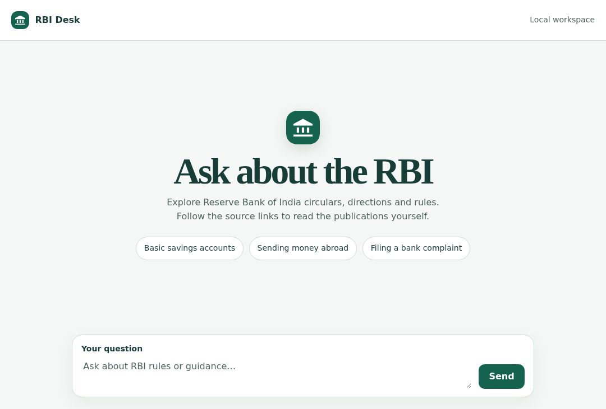
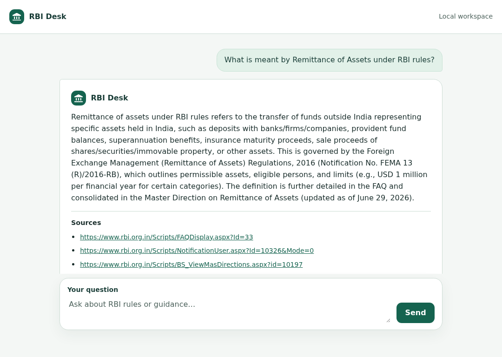
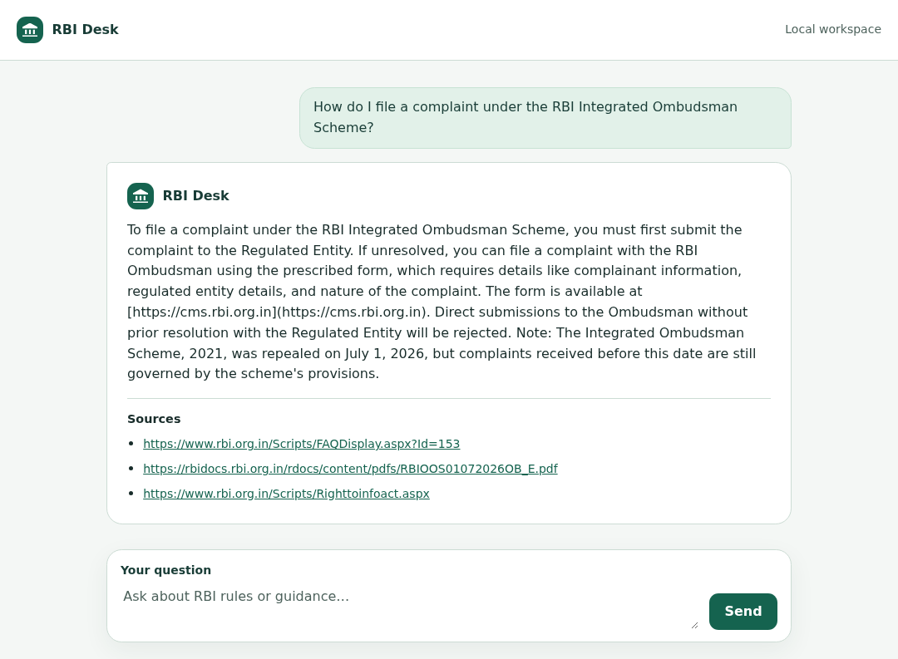
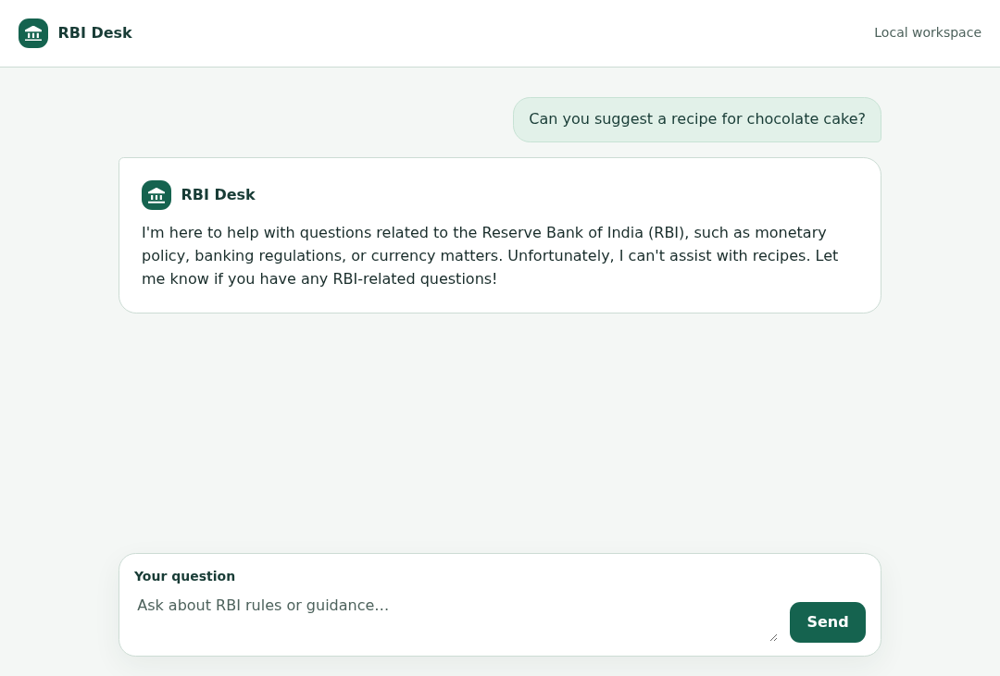
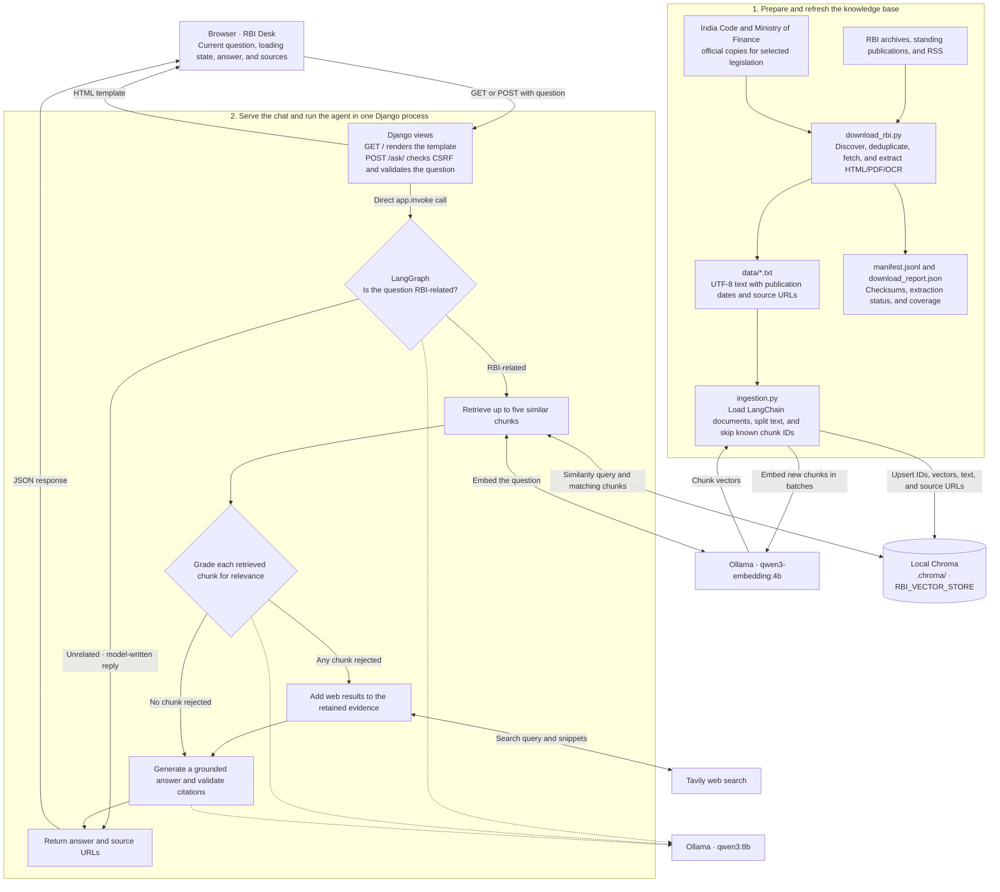
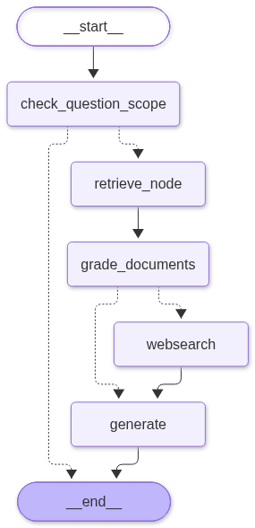

# RBI Desk · Agentic RAG

RBI Desk is a local question-and-answer app for Reserve Bank of India publications. It searches a corpus of RBI circulars, notifications, Master Directions, FAQs, and legislation, then uses a local Ollama model to answer with links to the sources it used. The LangGraph workflow decides whether to retrieve documents, search the web for additional material, or return a model-generated reply for an unrelated question.

The browser shows one exchange at a time. Each submission starts a fresh run, so a follow-up question should include the context it needs. Django serves the UI and invokes the agent in the same process. The app listens on loopback. The corpus downloader and the optional Tavily fallback make outbound requests.

## Run locally

Requirements are Python 3.13 or later, [uv](https://docs.astral.sh/uv/), and a running [Ollama](https://ollama.com/) instance. Building the corpus also requires Poppler's `pdftotext`. Install `pdftoppm`, Tesseract, and its English language data to extract scanned pages. On Debian and Ubuntu, those tools are in `poppler-utils`, `tesseract-ocr`, and `tesseract-ocr-eng`.

Run the following commands from the repository root to install the locked dependencies and download the two models.

```sh
uv sync --locked
ollama pull qwen3:8b
ollama pull qwen3-embedding:4b
```

If Ollama is stopped, run `ollama serve` in another terminal. Requests that take the web-search branch require `TAVILY_API_KEY` in the root `.env`.

```dotenv
TAVILY_API_KEY=your_key_here
```

The downloader and indexer prepare the data on a fresh checkout.

```sh
uv run --locked python download_rbi.py
uv run --locked python ingestion.py
```

You can reuse an existing `.chroma/` index on subsequent launches. Start Django and open [RBI Desk](http://127.0.0.1:8000/).

```sh
uv run --locked python backend/manage.py runserver 127.0.0.1:8000
```

The first answer can take a few minutes while Ollama loads the models and the agent grades retrieved passages. The chat shows a loading indicator immediately and displays the complete answer when it is ready.

## Example conversations

These screenshots show the local app. Answers and sources can vary with the active index, model, and web results.

### Ask a question

The home screen accepts a typed question and offers examples you can edit before sending.



### Ask about an RBI rule

**Question.** What is meant by Remittance of Assets under RBI rules?



### Ask about an RBI consumer scheme

**Question.** How do I file a complaint under the RBI Integrated Ombudsman Scheme?



### Ask an unrelated question

**Question.** Can you suggest a recipe for chocolate cake?

The scope classifier generates a brief reply inviting an RBI-related question. The agent skips retrieval and web search on this path, so the chat shows no sources.



## Architecture

The download and indexing commands prepare the local knowledge base. A chat request reads that index and runs the workflow inside Django.



### Agent workflow



| Node | What it does |
| --- | --- |
| `check_question_scope` | Classifies the question. For unrelated requests, the same model call writes a user-facing reply and the graph exits. |
| `retrieve_node` | Embeds the question with the same model used for indexing and retrieves up to five similar chunks from Chroma. |
| `grade_documents` | Uses the chat model to grade each retrieved chunk, retains relevant evidence, and enables web search when any retrieved chunk is rejected. |
| `websearch` | Uses Tavily to look up the question and appends up to three web results to the retained context, along with their URLs. |
| `generate` | Uses the retained context to produce an answer. The prompt prefers RBI publications and official legislation. Citation validation keeps only URLs present in the supplied evidence. |

The graph's final state carries the question, scope decision, generated text, cited URLs, web-search flag, and documents. The Django endpoint returns the user-facing fields as JSON, for example `{"answer": "...", "sources": ["https://www.rbi.org.in/..."]}`. It accepts a CSRF-protected form submission with a `question` field of up to 2,000 characters.

## Corpus and index

### Download and extract publications

[`download_rbi.py`](download_rbi.py) discovers English-language notifications, circulars, Master Circulars, and selected regulatory or consumer-facing press releases from RBI archives and feeds. Standing collections include Master Directions, FAQs, guidance, and the Legal Framework's Acts, rules, regulations, and schemes. Selected legislation uses official copies from India Code or the Ministry of Finance when needed.

The downloader extracts HTML or PDF text, uses OCR for scanned pages when available, and records extraction warnings. The default archive window covers the preceding three years in India time. Use explicit dates to reproduce the original backfill or to refresh a specific period.

```sh
uv run --locked python download_rbi.py --since 2023-11-25 --until 2026-11-25
uv run --locked python download_rbi.py --since 2023-11-25 --until 2026-11-25 --retry-incomplete
```

Use `--retry-incomplete` to reuse previously completed files and retry failed or partial extractions. `--workers` controls the concurrent requests and defaults to 10. The downloader can return a nonzero status when some sources are incomplete, even when it successfully writes other files and the coverage report.

| Output | Contents |
| --- | --- |
| `data/*.txt` | Extracted UTF-8 text and a metadata header containing the title, exact text source URL, and any available dates, status, and extraction notes. |
| `data/manifest.jsonl` | Per-document identifiers, source links, checksums, and extraction results. |
| `data/download_report.json` | Archive coverage, files by category, excluded press releases, and incomplete listings or downloads. |

A usable text file can still have a missing annexure. Check the report and manifest when auditing coverage. The downloader can preserve previously usable text when a source is temporarily unavailable.

### Convert text to a searchable index

[`ingestion.py`](ingestion.py) converts each text file into a LangChain `Document`. The whole file becomes `page_content`, and the header's `Text source URL` becomes `metadata["source"]`. The following steps build the index.

1. Splits the documents into chunks of up to 2,500 characters with a configured 400-character overlap.
2. Computes stable chunk IDs from the source URL and chunk text, then skips IDs already present in Chroma.
3. Embeds new text in batches of 32 using `qwen3-embedding:4b`.
4. Upserts the embeddings, chunk text, IDs, and source metadata into `RBI_VECTOR_STORE` under `.chroma/`.

For routine updates, rerun the downloader and then the indexer against the existing index. This adds new and changed chunks and retains earlier versions. Rebuild into a fresh index when you need it to mirror the current text files exactly. Corpus freshness depends on when you last ran both steps. Check cited dates and the official source for rules currently in force.

## Project layout

| Path | Purpose |
| --- | --- |
| [`download_rbi.py`](download_rbi.py) | Publication discovery, downloads, text extraction, and reports. |
| [`ingestion.py`](ingestion.py) | LangChain document loading, chunking, embedding, and Chroma access. |
| [`AgenticWorkflow/`](AgenticWorkflow/) | Graph, shared state, prompts, and agent nodes. |
| [`backend/core/`](backend/core/) | Django settings and root URL configuration. |
| [`backend/agent_service/`](backend/agent_service/) | Chat views, routes, Django template, CSS, JavaScript, and tests. |
| [`main.py`](main.py) | Command-line example that runs the graph against a sample question and prints the state. |
| [`tests/`](tests/) | Agent tests for scope, chunking, and retrieval. |

The downloaded corpus, index, local Django SQLite database, and `.env` are generated or configured locally and excluded from Git.

## Checks

These commands run the Django checks and chat endpoint tests.

```sh
uv run --locked python backend/manage.py check
uv run --locked python backend/manage.py test agent_service
```

Run the agent tests with `uv run --locked pytest`. The live retrieval tests require Ollama and the populated Chroma index. To run the graph without Django, use `uv run --locked python main.py`.
